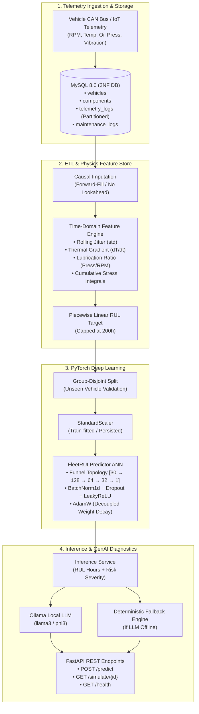

<div align="center">

# 🚛 FleetGuard AI
### Predictive Maintenance & Fleet Telemetry Engine
**High-Frequency Industrial Telemetry Ingestion • 3NF Relational Storage • PyTorch Deep Learning RUL Regression • Local GenAI Diagnostics via Ollama**

[](https://www.python.org/)
[](https://pytorch.org/)
[](https://www.mysql.com/)
[](https://fastapi.tiangolo.com/)
[](https://ollama.ai/)
[](https://opensource.org/licenses/MIT)

</div>

---

## 📌 Executive Overview

In commercial fleet operations, unexpected mechanical breakdowns cause millions in unplanned downtime, route delays, and safety hazards. Traditional preventative maintenance relies on static mileage intervals (e.g., service every 15,000 km), which either replaces healthy parts prematurely or misses fast-developing mechanical wear.

**FleetGuard AI** is a production-grade predictive maintenance platform that:
1. **Stores continuous IoT telemetry** in a normalized **Third Normal Form (3NF)** MySQL database with monthly range partitioning.
2. **Eliminates data leakage** via causal zero-order hold (ZOH) imputation and groups temporal splits across distinct vehicles.
3. **Engineers physics-based time-domain indicators** (vibrational spectral dispersion, thermal gradients, lubrication pressure-to-RPM ratios, cumulative fatigue integrals).
4. **Predicts Remaining Useful Life (RUL)** using a deep PyTorch Artificial Neural Network (ANN) trained with **AdamW** and **Mean Squared Error (MSE)**.
5. **Generates natural language dispatcher alerts** by injecting numerical tensor predictions into local **Ollama LLMs** (`llama3`), with zero-downtime deterministic fallbacks.

---

## 📐 System Architecture



---

## 🔬 Mathematical & Engineering Foundations

### 1. Causal Time-Series Imputation (Zero-Order Hold)
In industrial IoT, packet loss is common due to cellular dead zones. Standard mean or spline interpolation introduces **lookahead bias** by leaking future states ($t+1$) into past observations ($t$). We employ **Causal Forward-Fill**:
$$\hat{x}_t = x_{t-k} \quad \text{where } t-k \text{ is the most recent valid transmission}$$
This simulates physical zero-order hold (ZOH) hardware behavior and guarantees that our feature matrix only uses past information.

### 2. Time-Domain Physics Features
Raw sensor metrics are transformed into 30 physical wear signatures across sliding windows $w \in \{5, 15, 30\}$:
* **Vibrational Instability / Jitter ($\sigma_{\text{vibration}}$):**
  $$\sigma_w(t) = \sqrt{\frac{1}{w-1}\sum_{i=0}^{w-1}\left(x(t-i) - \bar{x}_w(t)\right)^2}$$
  *Mechanical insight:* Bearing micro-spalling and race wear display expanded variance before mean amplitude spikes.
* **Thermodynamic Rate of Change ($\nabla T$):**
  $$\nabla T_t = \frac{T_t - T_{t-1}}{\Delta t}$$
  Identifies cooling degradation regardless of engine operating point.
* **Lubrication Coupling Ratio:**
  $$\text{Ratio}_{\text{lubrication}} = \frac{\text{Oil Pressure}}{\text{Engine RPM} + \epsilon}$$
  At 1,200 RPM, 30 PSI is healthy; at 3,500 RPM, 30 PSI indicates pump cavitation or viscous breakdown.
* **Cumulative Mechanical Fatigue Integral:**
  $$\text{Stress}_{\text{cumulative}}(t) = \sum_{\tau=0}^{t} \left(\text{Vibration}_\tau \times \frac{\text{RPM}_\tau}{1000} \times \frac{\text{Speed}_\tau}{100}\right)$$

### 3. Piecewise Linear Remaining Useful Life (RUL)
Components experience an extended healthy plateau before physical wear initiates. Forcing an ANN to predict the difference between 600 hours and 500 hours on pristine hardware introduces noise. We cap the regression target at $RUL_{\text{max}} = 200\text{ hours}$:
$$RUL_{\text{piecewise}}(t) = \min(RUL_{\text{max}}, T_{\text{failure}} - t)$$

### 4. Loss Function & Optimization (AdamW)
* **Mean Squared Error (MSE):**
  $$\mathcal{L}_{\text{MSE}} = \frac{1}{N}\sum_{i=1}^N (y_i - \hat{y}_i)^2, \quad \frac{\partial \mathcal{L}}{\partial \hat{y}_i} = -\frac{2}{N}(y_i - \hat{y}_i)$$
  Penalizes critical errors quadratically ($e^2$), forcing the network to prioritize avoiding large misses.
* **AdamW (Decoupled Weight Decay):**
  $$\theta_t = \theta_{t-1} - \eta_t \left( \frac{\hat{\mathbf{m}}_t}{\sqrt{\hat{\mathbf{v}}_t} + \epsilon} + \lambda \theta_{t-1} \right)$$
  Decouples the regularization weight penalty ($\lambda = 10^{-4}$) from gradient moments, preventing overfitting to vehicle-specific sensor noise.

---

## 🗄️ Database Normalization (3NF)

The database schema is strictly normalized to **Third Normal Form (3NF)** to avoid update anomalies and data duplication:

| Table | Normalization & Design Purpose | Key Fields |
| :--- | :--- | :--- |
| `vehicles` | **1NF, 2NF, 3NF:** Vehicle metadata (VIN, make, model, odometer) | `vehicle_id` (PK), `vin` (UQ) |
| `components` | **3NF:** Tracks sub-assemblies (Engine, Transmission, Brakes) | `component_id` (PK), `vehicle_id` (FK) |
| `telemetry_logs` | **High-Frequency Partitioned:** Millisecond-level sensor feeds. Range partitioned monthly. | `(log_id, recorded_at)` (Composite PK), `vehicle_id` (FK) |
| `maintenance_logs` | **Ground Truth Interventions:** Component replacements and overhaul logs. Generated column for `total_cost`. | `maintenance_id` (PK), `vehicle_id` (FK) |
| `model_predictions`| **Audit Trail:** History of PyTorch predictions, risk levels, and synthesized LLM alerts. | `prediction_id` (PK), `vehicle_id` (FK) |

---

## 📂 Project Structure

```text
Fleet Ai/
├── database/
│   ├── schema.sql            # Production 3NF DDL with RANGE partitioning
│   ├── db_manager.py         # Thread-safe MySQL connection pool
│   └── seed_data.py          # Synthetic degradation physics & telemetry seeder
├── pipeline/
│   └── feature_pipeline.py   # Causal forward-fill, 30 rolling features, piecewise RUL
├── data/
│   └── dataset.py            # PyTorch TelemetryDataset, vehicle-disjoint split, StandardScaler
├── models/
│   ├── ann_model.py          # PyTorch FleetRULPredictor (Funnel MLP: 14,785 parameters)
│   ├── best_model.pt         # Checkpointed model weights (lowest validation RMSE)
│   └── scaler.joblib         # Fitted StandardScaler for real-time inference
├── training/
│   └── train.py              # Training loop, MSE loss, backprop, gradient clipping, early stopping
├── integration/
│   ├── ollama_client.py      # Prompt engineer & Ollama API client with offline fallback
│   ├── inference_service.py  # Inference orchestration (telemetry -> ANN -> Ollama -> MySQL audit)
│   └── api.py                # FastAPI HTTP REST service
├── requirements.txt          # Python dependencies
├── .env.example              # Environment variables template
└── README.md                 # Complete project documentation
```

---

## 🚀 Quick Start Guide

### 1. Prerequisites
* Python 3.10+ (Tested on Python 3.13)
* MySQL Server 8.0+
* [Ollama](https://ollama.ai/) (Optional, for real-time local LLM generation)

### 2. Environment Setup
```bash
# Clone the repository
git clone https://github.com/your-username/fleet-ai-predictive-maintenance.git
cd fleet-ai-predictive-maintenance

# Create and activate virtual environment
python -m venv venv
# On Windows:
.\venv\Scripts\activate
# On Linux/macOS:
source venv/bin/activate

# Install dependencies
pip install -r requirements.txt
```

### 3. Configure Environment Variables
Copy [.env.example](file:///.env.example) to `.env` and configure your MySQL and Ollama credentials:
```ini
DB_HOST=localhost
DB_PORT=3306
DB_USER=root
DB_PASSWORD=your_password
DB_NAME=fleet_telemetry_db

OLLAMA_BASE_URL=http://localhost:11434
OLLAMA_MODEL=llama3
```

---

## 🛠️ Step-by-Step Execution

### Step 1: Initialize Database & Seed Synthetic Fleet
```bash
# Run schema creation script
python database/db_manager.py

# Seed vehicles, components, and degradation telemetry
python database/seed_data.py
```

### Step 2: Test Feature Engineering Pipeline
```bash
python pipeline/feature_pipeline.py
```

### Step 3: Verify PyTorch DataLoaders & Scaling
```bash
python data/dataset.py
```

### Step 4: Train the Deep Learning Model
```bash
python training/train.py
```
*Evaluates model on completely unseen vehicles with learning rate decay and early stopping. Checkpoints optimal weights to `models/best_model.pt`.*

### Step 5: Start the API Service
```bash
# (Optional) Launch Ollama in a separate terminal:
ollama run llama3

# Start the FastAPI service:
python integration/api.py
```
Open **[http://localhost:8000/docs](http://localhost:8000/docs)** to view the interactive Swagger API documentation.

---

## 📡 API Reference & Examples

### Health Check
```http
GET /health
```
```json
{
  "status": "HEALTHY",
  "model_loaded": true,
  "scaler_loaded": true,
  "ollama_connected": true,
  "ollama_endpoint": "http://localhost:11434/api/generate"
}
```

### Run Telemetry Stream Prediction
```http
POST /predict
Content-Type: application/json
```
```json
{
  "vehicle_id": "VEH-1001",
  "odometer_km": 94250.0,
  "readings": [
    {
      "engine_rpm": 2200.0,
      "engine_temp_c": 108.4,
      "oil_pressure_psi": 26.2,
      "vibration_amplitude_g": 0.088,
      "vehicle_speed_kmh": 82.0,
      "fuel_flow_rate_lph": 28.5,
      "coolant_level_pct": 74.0,
      "intake_air_temp_c": 31.0,
      "battery_voltage": 14.1
    }
  ]
}
```

### Response with Ollama-Synthesized Diagnostic Alert
```json
{
  "prediction_id": "9b1deb4d-3b7d-4bad-9bdd-2b0d7b3dcb6d",
  "vehicle_id": "VEH-1001",
  "predicted_rul_hours": 14.2,
  "severity": "CRITICAL",
  "latest_telemetry_snapshot": {
    "engine_rpm": 2200.0,
    "engine_temp_c": 108.4,
    "oil_pressure_psi": 26.2,
    "vibration_amplitude_g": 0.088,
    "vibration_roll_std_5": 0.0142,
    "oil_pressure_rpm_ratio": 0.0119
  },
  "dashboard_alert": "1. SUMMARY OF RISK: CRITICAL OPERATIONAL ALERT. Vehicle VEH-1001 is exhibiting acute mechanical distress with an estimated Remaining Useful Life of 14.2 operating hours.\n\n2. ROOT CAUSE HYPOTHESIS: Elevated vibration amplitude (0.088G) coupled with high thermal readings (108.4°C) and depressed lubrication pressure ratio indicates impending journal bearing raceway fatigue and boundary lubrication breakdown.\n\n3. IMMEDIATE ACTION: Restrict engine RPM under 1,500. Divert vehicle immediately to the nearest regional maintenance hub within 10 operating hours for oil filter cut-and-inspect and acoustic bearing diagnostics.",
  "model_version": "PyTorch-Fleet-ANN-v1"
}
```

---

## 📊 Model Performance Metrics

Evaluated on an out-of-sample validation fleet (`VEH-1005`):

| Metric | Initial Epoch | Final Converged (Epoch 25) | Unit |
| :--- | :--- | :--- | :--- |
| **Validation MSE** | `10,313.04` | `997.29` | $\text{hours}^2$ |
| **Validation RMSE** | `101.55` | **`31.58`** | $\text{hours}$ |
| **Validation MAE** | `96.20` | **`28.79`** | $\text{hours}$ |

---

## 👨‍💻 Author & Maintainer

**Isuranda Dasanayake**  
*Python Developer & Machine Learning Engineer*

[](https://github.com/isurandadasanayake99-cyber)
[](mailto:iutechnical999@gmail.com)

---

## 🛡️ License

Distributed under the **MIT License**. See `LICENSE` for more information.

---

<div align="center">
Developed with ❤️ by <b>Isuranda Dasanayake</b> for High-Reliability Fleet Intelligence.
</div>
